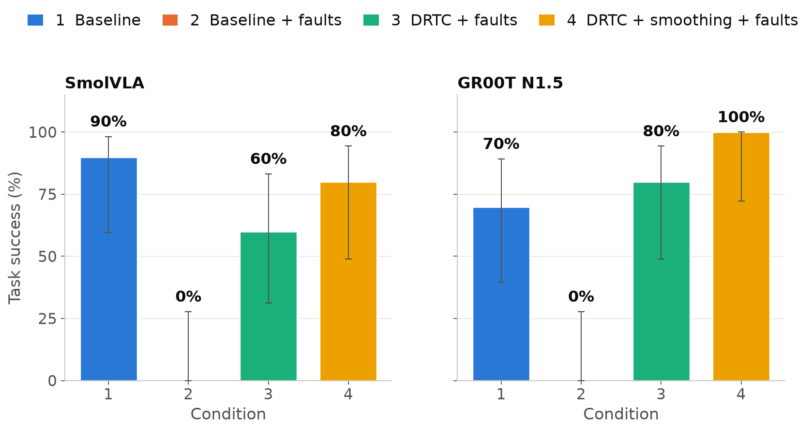

# Reliable remote inference for low-cost robot arms

Large robot policies (vision-language-action models of 0.45 to 3.4 billion parameters) are too big for the computer on
a low-cost arm, so they run on a GPU server and the robot depends on the network for every chunk of actions. This
repository is a complete system for that setting on LeRobot 0.7 and an SO-101 arm: recorded datasets, seven trained
policies, remote inference with **Distributed Real-Time Chunking (DRTC)** and four fixes we found on the real setup,
six command-smoothing methods, network fault injection, and an evaluation framework in which every number is rebuilt
from the raw records of the trials.



**First robot run** (sorting task, 80 trials). A mix of a 1 s latency spike, 1 s of lost replies and a 1.5 s outage:

| | SmolVLA | GR00T N1.5 |
|---|---|---|
| Normal network, LeRobot as shipped | 90% | 70% |
| Faults, LeRobot as shipped | 0% (the client ended every run) | 0% |
| Faults, DRTC | 60% | 80% |
| Faults, DRTC + smoothing | 80% (4.8× less jerk) | 100% (10.8× less jerk) |

A second, redesigned set of experiments (setup v2) compares DRTC with a LeRobot client that waits instead of giving
up, takes DRTC and the smoothing apart, and covers two tasks and seven policies on a replay bench. The results, the
method and every design decision are in the report (`report/`, about 75 pages).

## What is here

| Path | What |
|---|---|
| `src/drtc/` | the `lab` command: registry, training, recording and trimming, robot control, evaluation |
| `src/drtc/control/engine.py` | DRTC on LeRobot 0.7's remote-inference runtime (trigger, latency estimate, cooldown) |
| `src/drtc/control/smoothing.py`, `playback.py`, `action_filter.py` | the smoothing methods |
| `src/drtc/control/faults.py` | network fault injection in the client's transport |
| `plugins/` | LeRobot plugins: GR00T N1.5 on LeRobot 0.7, and a replay robot for the bench |
| `lab/` | the registry (datasets, recipes, models, rigs, conditions, evaluation plans) and the guides |
| `report/` | the project report (LaTeX), built from `results/` |
| `presentation/` | the slides (.pptx), the project video and the DRTC Fault Simulator, built from the same numbers |
| `viva/` | viva preparation: likely questions with answers from the results |
| `tests/` | the test suite (CPU; run in CI) |

**Start with [lab/README.md](lab/README.md)** for the guides: how it works, data, training, servers, evaluation, the
metrics and the full workflow with every command.

## Install

Python 3.12 and [uv](https://docs.astral.sh/uv/). LeRobot is pinned to 0.7.0 and every dependency is locked.

```bash
uv sync --extra gpu --extra sim      # a Linux machine with an NVIDIA GPU (laptop, server)
.venv/bin/python -m pytest -q        # the test suite
```

A Raspberry Pi as the robot computer: `lab/bin/pi-setup` (CPU PyTorch). Servers: `lab/docs/SERVERS.md`.

## Try it in a browser

The **DRTC Fault Simulator** shows LeRobot's client and DRTC side by side on the same network faults, with buttons
to break the network while it plays. It is a simplified model of the client's scheduling rules, checked against the
bench (`presentation/simulator/`):

```bash
python presentation/simulator/build.py     # then open presentation/out/drtc_simulator.html (works offline)
```

## Try it without a robot

The replay robot plays held-out recorded episodes as the cameras and joints, so the whole remote-inference loop runs
on one machine:

```bash
.venv/bin/lab serve smolvla_sort_one_v1_full --listen tcp/127.0.0.1:7950 &           # the policy server
.venv/bin/lab run v2/drtc__mix --model smolvla_sort_one_v1_full --robot replay \
    --endpoint tcp/127.0.0.1:7950 --trials 1 --no-label                              # DRTC under the fault mix
.venv/bin/lab results                                                                # stalls, chunks, faults
```

Swap `v2/drtc__mix` for `v2/upstream_patient__mix` to see LeRobot's own scheduling under the same faults; every
condition is a file in `lab/experiments/v2/`.

## Reproduce the results

Every official trial is stored raw in a results store on the Hugging Face Hub, and reports are rebuilt from it:

```bash
.venv/bin/lab eval report sort_one_drtc_main --pull     # one evaluation's tables and statistics
make -C report                                          # the report: numbers, tables, figures, PDF
.venv/bin/python presentation/build.py                  # the slides
.venv/bin/python presentation/video.py                  # the project video
```

## Credits

- **DRTC** is Jack Vial's method ([technical write-up](https://jackvial.com/posts/distributed-real-time-chunking.html));
  this repository started from his code, whose original readme is in
  [lab/docs/history/DRTC-ORIGINAL-README.md](lab/docs/history/DRTC-ORIGINAL-README.md). Our implementation on
  LeRobot 0.7, the fixes, the smoothing study and the evaluation are new.
- **LeRobot** (Hugging Face) provides the robot drivers, training, the policies and the remote-inference runtime.
- The policies are their authors': ACT, Diffusion Policy, SmolVLA, GR00T N1.5 and N1.7, π0.5 and MolmoAct 2, each
  trained with its published recipe (`lab/recipes/`).

Licensed under the Apache License 2.0 (`LICENSE`).
